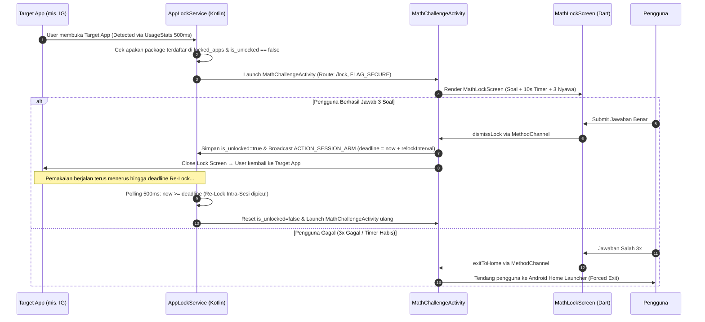

# 🛡️ BLUEPRINT ARSITEKTUR & DESAIN SISTEM: MATHLOCK V2
> **Dokumen Resmi Cetak Biru (Blueprint) Sistem Aplikasi LockMath / MathLock v2**  
> *Anti-Brainrot App Lock dengan Friksi Kognitif & Mekanisme Re-Lock Intra-Sesi Dinamis*

---

## 1. RINGKASAN EKSEKUTIF & SPESIFIKASI PROYEK

**MathLock v2** (paket: `com.danibaret014.mathlock`) adalah aplikasi pengunci aplikasi Android berbasis Flutter yang memicu *cognitive friction* (friksi kognitif) dalam bentuk soal tantangan matematika sebelum dan di tengah sesi pemakaian aplikasi target (Instagram, TikTok, Games, dll). 

Tujuan utama dari sistem ini adalah menekan kecenderungan *Problematic Smartphone Use* (PSU) dan *Doomscrolling* dengan memaksa otak melakukan peralihan dari mode otomatis (*System 1*) ke mode analitis (*System 2*).

| Parameter | Spesifikasi |
|---|---|
| **Nama Proyek** | MathLock v2 (Cobalt Fortress) |
| **Package Name** | `com.danibaret014.mathlock` |
| **Versi Saat Ini** | `7.1.0+8` |
| **Kerangka Utama** | Flutter (SDK `^3.11.4`), Dart 3.x |
| **Layer Native** | Kotlin (Android SDK minSdk 21+, Target/Compile SDK 34) |
| **Backend & Cloud** | Supabase Auth & PostgreSQL Cloud Database |
| **Database Lokal** | SQLite via `sqflite` (database `cobalt_fortress.db`) |
| **State Management** | `ChangeNotifier` (`AppState`) & `ListenableBuilder` |
| **Lisensi** | Private Repository (`publish_to: 'none'`) |

---

## 2. ARSITEKTUR SISTEM & DIAGRAM ALIR

Sistem ini terdiri dari dua layer utama: **Flutter Client App (Dart)** untuk antarmuka pengguna & manajemen state, dan **Native Android Service (Kotlin)** yang berjalan secara *persistent foreground service* di latar belakang.

```
┌─────────────────────────────────────────────────────────────────────────┐
│                      FLUTTER CLIENT APP (DART)                          │
│                                                                         │
│  ┌────────────────────┐   ┌────────────────────┐   ┌─────────────────┐  │
│  │    AuthWrapper     │   │    MainScaffold    │   │ SettingsScreen  │  │
│  │ (Supabase Login)   │   │  (App List & Stats)│   │(Re-lock & Diff) │  │
│  └─────────┬──────────┘   └─────────┬──────────┘   └────────┬────────┘  │
│            │                        │                       │           │
│            └────────────────────────┼───────────────────────┘           │
│                                     ▼                                   │
│                         AppState (ChangeNotifier)                       │
│                                     │                                   │
│           ┌─────────────────────────┼────────────────────────┐          │
│           ▼                         ▼                        ▼          │
│   DatabaseService           SupabaseService         AppLockNativeService│
│   (SQLite Lokal)            (Cloud Sync/Auth)        (MethodChannel)    │
└───────────┬─────────────────────────┬────────────────────────┬──────────┘
            │                         │                        │
            ▼                         ▼                        ▼
┌───────────────────────┐ ┌───────────────────────┐ ┌───────────────────────┐
│ SQLite Database       │ │ Supabase Cloud DB     │ │ NATIVE KOTLIN SERVICE │
│ (cobalt_fortress.db)  │ │ (user_settings &      │ │                       │
│ - unlock_events (v3)  │ │  unlock_events)       │ │ - AppLockService      │
└───────────────────────┘ └───────────────────────┘ │   (UsageStats 500ms)  │
                                                    │ - MathChallengeActiv  │
                                                    │   (FLAG_SECURE, /lock)│
                                                    │ - MainActivity        │
                                                    │   (SharedPreferences) │
                                                    └───────────────────────┘
```

---

## 3. STRUKTUR FOLDER & KOMPONEN UTAMA

```
mathlockv2/
├── android/app/src/main/kotlin/com/danibaret014/mathlock/
│   ├── AppLockService.kt           # Native Foreground Service, polling UsageStats 500ms & timer re-lock
│   ├── MathChallengeActivity.kt    # Dedicated FlutterActivity untuk layar kunci (FLAG_SECURE & no-back)
│   └── MainActivity.kt             # Main entry point & penyedia MethodChannel applock
├── lib/
│   ├── main.dart                   # Entry point Flutter & deteksi rute khusus /lock
│   ├── config/
│   │   ├── app_config.dart         # Global feature flags (enableAds, enableAppLock, enablePremiumRestrictions)
│   │   └── supabase_config.dart    # Konfigurasi URL & Anon Key Supabase
│   ├── screens/                    # Layar aplikasi utama
│   │   ├── app_list_screen.dart    # Daftar aplikasi terinstall & saklar kunci per-app
│   │   ├── auth_wrapper.dart       # Penjaga autentikasi (Login check)
│   │   ├── history_screen.dart     # Riwayat pembukaan kunci & ekspor data
│   │   ├── home_screen.dart        # Dashboard utama, status proteksi, & statistik cepat
│   │   ├── lock_route_screen.dart  # Bridge native → MathLockScreen saat app dikunci
│   │   ├── login_screen.dart       # Login email/password & Google Sign-In
│   │   ├── main_scaffold.dart      # Bottom navigation bar & container layar utama
│   │   ├── math_lock_screen.dart   # UI Tantangan Matematika, timer, nyawa & keypad
│   │   ├── privacy_policy_screen.dart# Kebijakan privasi aplikasi
│   │   ├── register_screen.dart    # Registrasi akun baru
│   │   ├── settings_screen.dart    # Pengaturan tingkat kesulitan & durasi Re-Lock Intra-Sesi
│   │   └── stats_screen.dart       # Grafik & analitik pola penggunaan
│   ├── services/
│   │   ├── ad_service.dart         # Integrasi Iklan Google Mobile Ads (AdMob)
│   │   ├── app_lock_native_service.dart # Wrapper MethodChannel dari Dart ke Kotlin
│   │   ├── database_service.dart   # Manajemen SQLite lokal (tabel unlock_events v3)
│   │   ├── preferences_service.dart# Wrapper SharedPreferences (Master Lock, Difficulty, Re-lock)
│   │   └── supabase_service.dart   # Manajemen Auth Supabase & sinkronisasi cloud
│   ├── state/
│   │   └── app_state.dart          # Central State Provider (ChangeNotifier)
│   ├── theme/
│   │   └── app_theme.dart          # Theme token, warna HSL glassmorphism, & dark mode
│   └── widgets/                    # Component reusables
│       ├── ambient_glow.dart       # Dynamic background lighting effect
│       ├── glow_container.dart     # Container efek glow & border teratur
│       ├── mock_ad_banner.dart     # AdMob banner wrapper & fallback
│       ├── permission_wizard.dart  # Dialog bantuan izin Usage Access & Draw Over Apps
│       └── premium_upgrade_sheet.dart # Bottom sheet langganan premium
└── pubspec.yaml                    # Konfigurasi dependensi & versi (7.1.0+8)
```

---

## 4. MEKANISME PENGUNCIAN & RE-LOCK INTRA-SESI (CORE WORKFLOW)

Mekanisme penguncian aplikasi bekerja dengan alur berikut:



### Fitur Penguncian Unggulan:
1. **Intra-Session Re-Lock (Dynamic Interval)**:
   * Pengguna dapat memilih interval re-lock di Pengaturan: **5 Menit**, **10 Menit**, **15 Menit** (Default), **30 Menit**, **60 Menit**, atau **3 Detik (Dev Test Mode)** saat development (`kDebugMode`).
   * Jika aplikasi target terus dibuka tanpa henti melampaui deadline, `AppLockService` akan memicu layar kunci ulang (*mid-session re-challenge*).
2. **Screen-Off Re-Lock**:
   * Begitu layar ponsel dimatikan (`ACTION_SCREEN_OFF`), status `is_unlocked` langsung dicabut, sehingga saat ponsel dinyalakan kembali, aplikasi otomatis terkunci.
3. **Anti-Bypass Protection**:
   * Layar pengunci menggunakan `FLAG_SECURE` (mencegah screenshot & rekaman layar).
   * Menimpa `onBackPressed()` sehingga tombol kembali perangkat tidak dapat menembus kunci.
4. **Forced-Exit & Retry Tracking**:
   * Jika pengguna gagal 3 kali, aplikasi akan menendang pengguna ke *Android Home Launcher*. Jika pengguna langsung mencoba membuka aplikasi target kembali, sistem mencatatnya sebagai `isRetry = 1` untuk analitik kurva *habit extinction*.

---

## 5. GENERASI SOAL MATEMATIKA (ENGINE)

Fungsi `generateQuestion(int difficulty)` di `math_lock_screen.dart` menghasilkan soal dinamis berdasarkan level kesulitan yang dipilih:

| Level | Kode | Kategori | Rumus Generasi Soal | Contoh Soal |
|---|---|---|---|---|
| **0** | `SD` | DASAR | $a \text{ op } b, \text{ op } \in \{+, -, \times\}, a,b \in [1, 20]$ | `7 × 8 = ?` |
| **1** | `SMP` | AKTIF | $a \times b \pm c, \quad a,b \in [2, 12], c \in [1, 30]$ | `12 × 5 + 7 = ?` |
| **2** | `SMA` | LANJUT | $a^2, \sqrt{n}, a \times b + c, \quad a \in [2, 25]$ | `√144 = ?` atau `15² = ?` |
| **3** | `PT` | PAKAR | Persamaan Linear: $a(x + b) + c = d(x + e)$, solusi $x \notin \{0, 1, -1\}$ | `3(x + 2) + 4 = 5(x - 1), x = ?` |

---

## 6. MODEL DATA & SINKRONISASI CLOUD

### A. Tabel SQLite Lokal (`cobalt_fortress.db` - v3)
Tabel `unlock_events` menyimpan setiap interaksi penguncian secara mendalam:

```sql
CREATE TABLE unlock_events (
    id INTEGER PRIMARY KEY AUTOINCREMENT,
    packageName TEXT NOT NULL,
    appName TEXT NOT NULL,
    timestamp INTEGER NOT NULL,
    success INTEGER NOT NULL,          -- 1 = Berhasil, 0 = Gagal
    attempts INTEGER NOT NULL,         -- Jumlah percobaan submit
    durationMs INTEGER NOT NULL,       -- Durasi pengerjaan soal (ms)
    formula TEXT NOT NULL,             -- Teks rumus soal
    answer INTEGER NOT NULL,            -- Jawaban benar
    isSynced INTEGER NOT NULL DEFAULT 0,-- Status sync ke Supabase
    sessionId TEXT,                    -- Unique ID per sesi pemakaian (<pkg>-<startMs>)
    sessionStartMs INTEGER,            -- Epoch ms mulai sesi
    sessionEndMs INTEGER,              -- Epoch ms akhir sesi
    lockReason TEXT,                   -- 'initial' | 'relock' | 'screen_off' | 'forced_exit'
    forcedExit INTEGER DEFAULT 0,      -- 1 = Ditendang ke home launcher
    isRetry INTEGER DEFAULT 0          -- 1 = Buka ulang app setelah forced exit
);
```

### B. Tabel Cloud Supabase (`PostgreSQL`)
1. **`user_settings`**:
   * `user_id` (UUID PK)
   * `master_lock_enabled` (BOOLEAN)
   * `difficulty_level` (INT)
   * `relock_interval_minutes` (INT)
   * `biometric_enabled` (BOOLEAN)
   * `is_dark_theme` (BOOLEAN)
   * `is_premium` (BOOLEAN)
   * `premium_expiry` (BIGINT)
   * `locked_packages` (TEXT[])
   * `updated_at` (TIMESTAMPTZ)
2. **`unlock_events`**:
   * Memiliki struktur kolom identik dengan SQLite (snake_case) dengan proteksi **Row Level Security (RLS)** sehingga setiap pengguna hanya dapat membaca/menulis data miliknya sendiri.

---

## 7. FEATURE FLAGS & STRATEGI PELEPASAN RILIS

Konfigurasi terpusat di `lib/config/app_config.dart`:

```dart
class AppConfig {
  static const bool enableAds = false;                 // Saklar AdMob Ads
  static const bool enableAppLock = true;              // Saklar Native AppLock Service
  static const bool enablePremiumRestrictions = false; // Saklar Gating Fitur Premium
}
```

* **Development Mode**: `kDebugMode` mengaktifkan chip **⚡ 3 Detik (Dev Test)** di menu Pengaturan untuk pengujian instan.
* **Production Release**: `flutter build appbundle --release` secara otomatis menyembunyikan chip Dev Test tanpa perlu mengubah/menghapus kode manual.

---

## 8. DEPLOYMENT & RELEASE PIPELINE

### Prasyarat Environment
* File `.env` berisi `SUPABASE_URL`, `SUPABASE_ANON_KEY`, dan `GOOGLE_WEB_CLIENT_ID`.
* File `android/key.properties` terkonfigurasi dengan lokasi `upload-keystore.jks` dan alias `upload`.

### Perintah Build & Maintenance

```powershell
# 1. Menjalankan Mode Pengujian (Debug)
flutter run -d emulator-5554

# 2. Pembersihan Cache Build jika terjadi Gradle/Kotlin Conflict
flutter clean
Remove-Item -Recurse -Force android\.gradle -ErrorAction SilentlyContinue
Remove-Item -Recurse -Force build -ErrorAction SilentlyContinue
flutter pub get

# 3. Build Rilis Resmi untuk Google Play Store
flutter build appbundle --release
# Hasil output: build\app\outputs\bundle\release\app-release.aab
```

---

## 9. ROADMAP PENGEMBANGAN LEBIH LANJUT (FUTURE IMPROVEMENTS)

1. **Auto-Start & Boot Receiver**: Menambahkan `BroadcastReceiver` untuk `ACTION_BOOT_COMPLETED` agar `AppLockService` otomatis berjalan begitu HP di-restart.
2. **Interval Re-Lock Progresif (M3)**: Eskalasi otomatis interval penguncian (misal: 15m → 10m → 5m) seiring makin lamanya sesi pemakaian nonstop.
3. **Pembayaran Lokal (iPaymu Integration)**: Pengintegrasian Payment Gateway iPaymu via Supabase Edge Functions sebagai alternatif Google Play Billing.

---
*Dokumen ini dibuat secara otomatis oleh Antigravity AI Engine untuk repositori MathLock v2.*
